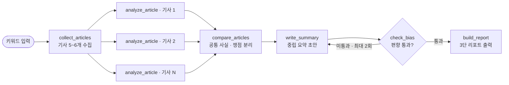

# 뉴스 프레임 비교 멀티에이전트 기획안

작성일 2026-11-10

## 1. 프로젝트 개요

같은 사건을 다룬 여러 언론사 기사를 에이전트가 병렬로 분석해, **모두가 동의하는 사실**과 **언론사별 시각 차이**를 나눠 보여주는 LangGraph 기반 뉴스 비교 서비스입니다.

같은 사건도 언론사마다 강조하는 사실, 쓰는 표현, 빠뜨리는 맥락이 다릅니다. 독자가 기사를 하나씩 열어 비교하기는 시간이 많이 들고, 비교하다 보면 어느 부분이 사실이고 어느 부분이 관점인지 구분하기도 어렵습니다. 이 프로젝트는 그 비교 과정을 멀티에이전트로 자동화합니다.

## 2. 목표 및 범위

핵심 목표는 키워드 하나를 넣으면 언론사 5~6곳의 기사를 비교한 리포트가 나오는 에이전트 그래프를 3일 안에 동작하게 만드는 것입니다.

| 구분 | 내용 |
| --- | --- |
| 하는 것 | 기사 수집, 언론사별 병렬 분석, 공통 사실·쟁점 비교, 중립 요약, 편향 검증 루프 |
| 하지 않는 것 | 언론사 정치 성향 라벨링, 기사 진위 판정, 사용자 계정·로그인, 실시간 크롤링 스케줄링 |
| 입력 | 사건 키워드 1개 (예: 특정 정책 발표, 사고 등) |
| 출력 | 사실 / 시각 차이 / 함께 읽어볼 포인트 3단 구성 리포트 |
| 실행 형태 | FastAPI |

언론사의 정치 성향을 미리 정해 두지 않고, 기사 본문에 나타난 강조·생략·어조 차이만 비교합니다.

## 3. 핵심 기능 및 사용 시나리오

사용자는 키워드 한 줄만 입력하고, 시스템이 기사 수집부터 비교 리포트까지 자동으로 수행합니다.

1. **입력**: "사건 키워드"를 입력합니다.
2. **기사 수집**: 관련 기사를 모으고 언론사가 겹치지 않도록 5~6개를 고릅니다.
3. **언론사별 분석**: 기사마다 핵심 주장, 강조한 사실, 빠뜨린 사실, 어조를 뽑습니다.
4. **비교**: 여러 기사에 공통된 사실과 언론사마다 갈리는 지점을 나눕니다.
5. **중립 요약 및 검증**: 요약에 한쪽 관점이 섞였는지 확인하고, 섞였으면 다시 작성합니다.
6. **출력**: 3단 구성 리포트를 보여줍니다.

최종 리포트 구성 예시는 다음과 같습니다.

| 항목 | 내용 |
| --- | --- |
| ① 모두가 동의하는 사실 | 여러 언론사가 공통으로 보도한 내용을 불릿으로 정리 |
| ② 시각 차이 | 언론사별 강조·생략·표현 차이를 비교한 표 |
| ③ 함께 읽어볼 포인트 | 자신이 확인해야 할 질문 2~3개 |

## 4. LangGraph 에이전트 아키텍처

그래프는 수집, 병렬 분석, 비교, 요약, 편향 검증 순으로 흐르고, 검증에 실패한 요약만 다시 작성 단계로 돌아갑니다.



`analyze_article`은 기사 수만큼 병렬로 실행되어 결과가 `compare_articles`로 합쳐지며, `check_bias`를 통과하지 못한 요약은 최대 2회까지 `write_summary`로 되돌아갑니다.

## 5. State 설계

그래프 전체가 공유하는 State는 여덟 개 필드로 구성합니다. 병렬 분석 결과는 `analyses`에 리스트로 합쳐지도록 reducer(`operator.add`)를 씁니다.

| 필드 | 타입 | 설명 |
| --- | --- | --- |
| `query` | str | 사용자가 입력한 사건 키워드 |
| `articles` | list[Article] | 수집된 기사 (언론사, 제목, 본문, URL, 발행일) |
| `analyses` | list[ArticleAnalysis] (reducer: add) | 기사별 분석 결과 (핵심 주장, 강조한 사실, 어조) |
| `comparison` | Comparison | 공통 사실, 쟁점 차이, 빠진 사실 비교 결과 |
| `summary` | str | 중립 요약 초안 |
| `bias_check` | BiasCheck | 요약에 한쪽 관점이 섞였는지 판정 (통과 여부, 지적 사항) |
| `retry_count` | int | 재작성 횟수 (최대 2회로 제한) |
| `report` | str | 최종 출력 리포트 |

## 6. 노드별 상세 설계

노드는 여섯 개이며, 언론사별 분석 노드만 기사 수만큼 병렬로 실행됩니다.

| 노드 | 역할 | 입력 → 출력 | 프롬프트 방향 |
| --- | --- | --- | --- |
| `collect_articles` | 키워드로 기사 검색 후 언론사가 겹치지 않게 5~6개 선택 | `query` → `articles` | 도구 호출(뉴스 검색 API), 중복·단순 전재 기사 제거 |
| `analyze_article` | 기사 한 건을 분석 (기사 수만큼 병렬) | 기사 1개 → `analyses`에 추가 | 주장 / 강조한 사실 / 인용한 출처 / 어조를 구조화된 JSON으로 추출 |
| `compare_articles` | 분석 결과를 가로로 비교 | `analyses` → `comparison` | 공통 사실, 갈리는 지점, 한두 곳만 다룬 사실을 분리 |
| `write_summary` | 중립 요약 초안 작성 | `comparison` → `summary` | 판단·평가 표현을 빼고 사실 위주로 서술 |
| `check_bias` | 요약에 한쪽 관점이 섞였는지 검사 | `summary` → `bias_check` | 평가용 프롬프트를 분리해 문장 단위로 문제 표현을 지적 |
| `build_report` | 최종 3단 리포트 조립 | 전체 State → `report` | 사실 / 시각 차이 / 함께 읽어볼 포인트 형식으로 출력 |

`check_bias`가 통과하지 못하면 지적 사항을 넣어 `write_summary`로 되돌리며, `retry_count`가 2에 도달하면 그대로 `build_report`로 진행합니다.

## 7. 기술 스택 및 폴더 구조

에이전트 오케스트레이션은 LangGraph, 기사 수집은 뉴스 검색 API, LLM은 Vertex AI, 화면은 FastAPI로 최소한의 구성을 잡습니다.

| 영역 | 선택 | 이유 |
| --- | --- | --- |
| 언어 | Python | 기존 LangGraph 생태계와 자료가 가장 많음 |
| 그래프 | LangGraph | 병렬 분기(`Send`), 조건부 엣지, 재시도 루프를 지원 |
| LLM | Vertex AI (Google ADC 인증) | 구조화 출력(JSON schema)로 분석 결과를 받기 쉬움 |
| 기사 수집 | 네이버 뉴스 검색 API, 본문은 URL 접속 후 추출 | 출처가 분명하고 언론사 다양성이 확보됨 |
| 데이터 검증 | Pydantic | 노드 간 State 형태를 일정하게 유지 |
| 화면 | FastAPI | 그래프를 API로 노출하고 화면에서 호출 |

폴더 구조는 다음과 같이 노드별 파일로 나눕니다.

```text
news-frame-compare/
├─ app.py                 # FastAPI 진입점
├─ graph.py               # StateGraph 구성
├─ state.py               # State, Pydantic 모델
├─ nodes/
│  ├─ collect.py
│  ├─ analyze.py
│  ├─ compare.py
│  ├─ summarize.py
│  ├─ check_bias.py
│  └─ report.py
├─ prompts/               # 노드별 프롬프트 텍스트
├─ tools/
│  └─ news_search.py      # 검색 API 호출, 본문 추출
├─ samples/               # 테스트용 기사 저장본
└─ .env.example
```

## 8. 데이터 수집 방법

기사 목록은 네이버 뉴스 검색 API로 받고, 본문은 각 기사 URL에 접속해 추출합니다.

1. **API 등록**: 네이버 개발자센터에서 애플리케이션을 등록하고 검색 API의 Client ID와 Secret을 발급받아 `.env`에 저장합니다.
2. **기사 목록 요청**: `news.json` 엔드포인트에 `query`, `display=100`, `sort`를 넘기면 제목, 원문 URL(`originallink`), 네이버 URL(`link`), 요약, 발행일이 옵니다. 본문은 포함되지 않습니다.
3. **언론사 선별**: `originallink`의 도메인별로 묶어 도메인당 1건만 남기고, 그중 5~6개를 선택합니다.
4. **본문 추출**: `trafilatura` 같은 범용 추출 라이브러리로 원문 URL에서 본문을 뽑습니다. 네이버 뉴스 URL은 BeautifulSoup으로도 추출할 수 있습니다.
5. **폴백**: 본문 추출에 실패하면 API가 준 요약만으로 분석합니다.

개발 중에는 `samples/`에 저장해 둔 기사를 재사용해 API 호출 한도와 크롤링 실패의 영향을 줄이고, 화면에는 본문 전문 대신 요약과 원문 URL만 표시합니다.

## 9. 개발 일정 (3일)

일정은 3일이며, 둘째 날 끝까지 키워드에서 리포트까지 전체 흐름이 돌아가는 것을 목표로 합니다.

| 일차 | 작업 | 산출물 |
| --- | --- | --- |
| 1일차 · 뼈대 만들기 | State·Pydantic 모델 정의, 검색 API로 기사 수집, 단건 분석 노드 구현 | 수집 + 단건 분석 동작 |
| 2일차 · 그래프 완성 | 기사별 병렬 분석 연결, 비교·요약 노드 연결, 편향 검증 루프 추가 | 키워드→리포트 전체 동작 |
| 3일차 · 다듬기와 시연 | FastAPI 화면 구성, 샘플 사건 3개로 테스트, README와 도식 정리 | 시연 가능한 데모 |

## 10. 리스크와 대응

가장 큰 리스크는 기사 본문 수집과 LLM 분석의 신뢰성이며, 두 가지 모두 샘플 데이터와 근거 인용 규칙으로 줄입니다.

| 리스크 | 영향 | 대응 |
| --- | --- | --- |
| 언론사 본문 수집이 막히거나 형식이 제각각임 | 분석할 기사가 부족해짐 | 검색 API의 제목·요약만으로도 동작하는 폴백 모드, `samples/` 폴더에 테스트 기사 저장 |
| LLM이 기사에 없는 내용을 만듦 (환각) | 시각 차이 분석이 부정확해짐 | 분석 출력에 기사 내 원문 근거 문장을 필수로 포함시키고, 근거가 없는 항목은 제외 |
| 중립 요약에 관점이 섞임 | 프로젝트의 핵심 가치가 흐려짐 | `check_bias` 검증 루프(최대 2회), 평가 프롬프트를 요약 프롬프트와 분리 |
| 기사 저작권 | 본문 재배포 시 문제가 될 수 있음 | 리포트에는 본문 전문을 싣지 않고 요약과 원문 URL만 표시 |
| 일정 지연 | 3일 안에 완성 못 함 | 일차별 산출물을 고정하고, 화면(FastAPI)은 마지막 날로 미룸 |

## 11. 기대 효과 및 확장 아이디어

이 프로젝트는 LangGraph의 병렬 실행, State 공유, 조건부 재시도 루프를 한 번에 보여주는 포트폴리오 사례가 됩니다.

**포트폴리오 어필 포인트**

- 병렬 분기 후 결과를 reducer로 합치는 구조를 직접 설계
- 생성과 평가를 분리한 검증 루프로 LLM 출력 품질 관리
- 구조화 출력(Pydantic)으로 노드 간 데이터 계약 정의

**확장 아이디어**

- 시간 순 타임라인 노드를 추가해 사건 전개에 따른 보도 변화 비교
- 사용자 피드백(Human-in-the-loop)으로 비교 대상 언론사를 직접 선택
- 대화형 후속 질문 에이전트로 확장 ("이 기사는 왜 이 부분을 뺐을까?")
- 체크포인터를 붙여 분석 세션 저장·재개
